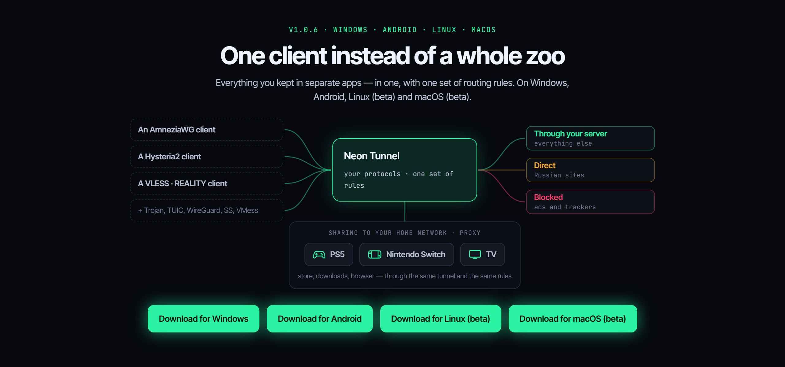
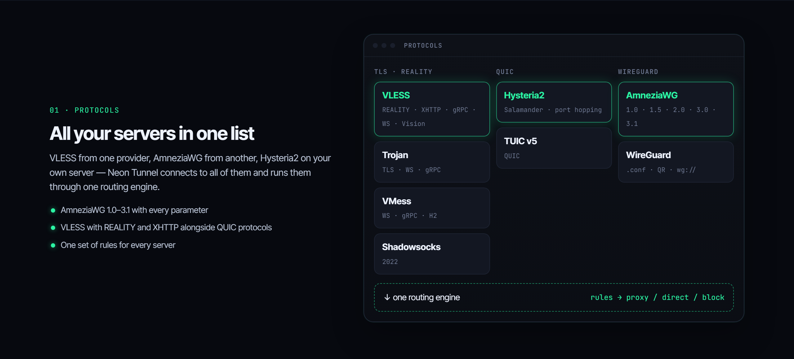
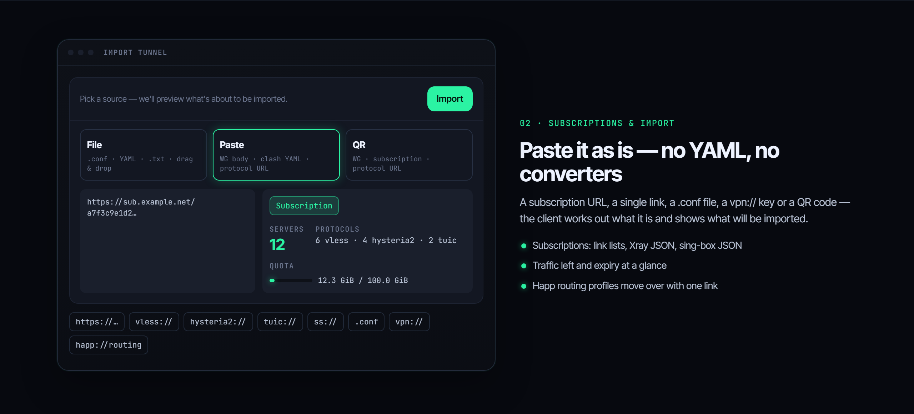
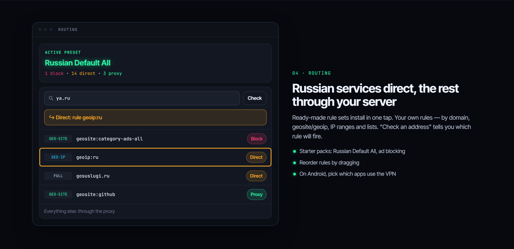
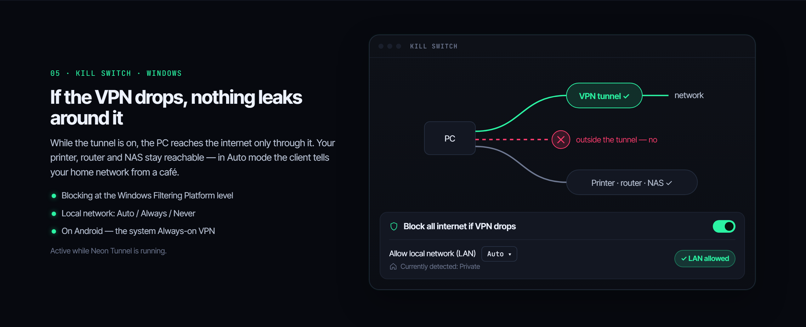
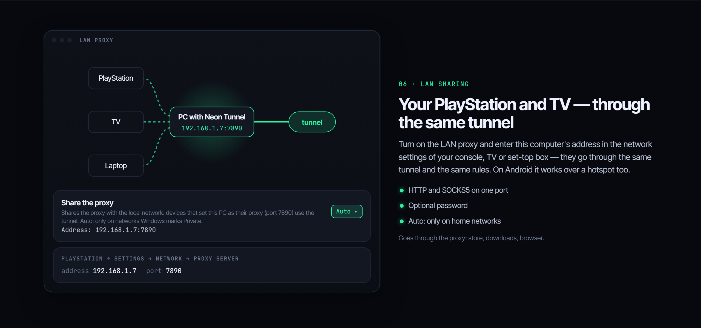
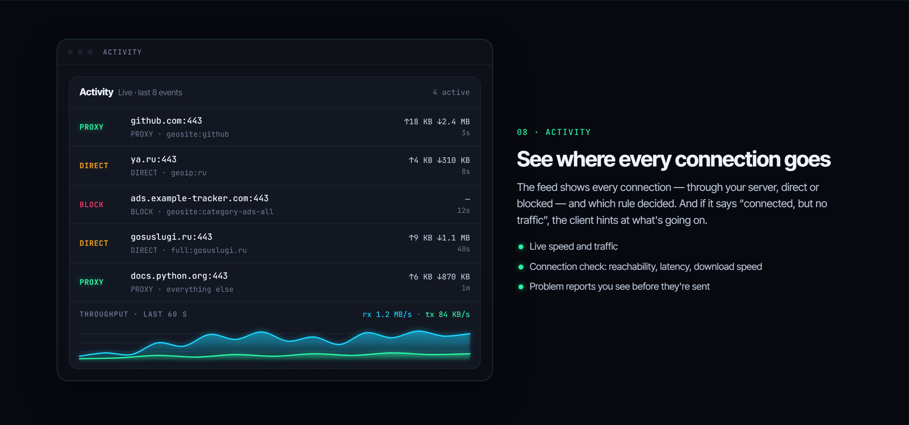

# Neon Tunnel

**One client instead of a zoo.** Everything you kept in separate apps, in one, with shared routing rules. For Windows, Android, Linux (beta) and macOS (beta).

**[Download the latest version](https://github.com/neontunnel/neontunnel/releases/latest)** · Website: **[neontunnel.pro](https://neontunnel.pro/)** · [Русский](#русский)

## Download

Latest version: **[Releases → Latest](https://github.com/neontunnel/neontunnel/releases/latest)**. These are the website's builds, byte for byte: each release lists the SHA-256 of every file, check it before you install. This is a mirror for when the website cannot be reached.

| System | File |
|---|---|
| Windows, x64 | `neon_tunnel_setup_<version>.exe` |
| Android, arm64 | `neon_tunnel_<version>.apk` |
| Linux x64, beta (Debian, Ubuntu) | `neon-tunnel_<version>_amd64.deb` |
| macOS, beta (Intel and Apple Silicon) | `NeonTunnel-<version>-macos.dmg` |

## What it does

### All your servers in one list

VLESS with REALITY and XHTTP, Hysteria2, TUIC, AmneziaWG 1.0–3.1 with every parameter, WireGuard, Trojan, Shadowsocks, VMess. One set of rules for any server.

### Paste it as it is

A subscription link, a single link, a `.conf` file, a `vpn://` key or a QR code: the client works out what it is. Subscriptions as a list of links, Xray JSON or sing-box JSON, with the traffic left and the expiry date. Works with 3x-ui, Remnawave (the device limit only with your consent), the official Hysteria2 server and AmneziaWG; keys from the Amnezia app import as they are.

### Russian services direct, the rest through your server

Ready-made rule sets in one tap, your own rules by domain, geosite/geoip and IP ranges, ad blocking. "Check an address" tells you which rule will fire. On Android, choose which apps use the VPN.

### Kill switch

If the tunnel drops, traffic does not leak past it, while the printer, router and NAS at home stay reachable. Windows and Linux; on Android, the system's "Always-on VPN".

### Your PlayStation and TV through the same tunnel

Sharing to your home network: consoles and TVs go through the same tunnel, by the same rules.

### See where every connection goes

The feed shows every connection, through your server, direct or blocked, and which rule decided. Live speed and traffic, a connection check, and problem reports you see before they are sent.

## Source code and security

The source code is closed. The Windows builds are signed, and every build's SHA-256 is published. How the app and the website handle data: [neontunnel.pro/privacy/](https://neontunnel.pro/privacy/).

Bugs and ideas: the form on the [website](https://neontunnel.pro/#feedback) or [Issues](https://github.com/neontunnel/neontunnel/issues).

---

## Русский

**Один клиент вместо зоопарка.** Всё, что вы держали в разных приложениях, в одном, с общими правилами маршрутизации. Для Windows, Android, Linux (бета) и macOS (бета).

Сайт: **[neontunnel.pro](https://neontunnel.pro/ru/)**

**Скачать:** [Releases → Latest](https://github.com/neontunnel/neontunnel/releases/latest). Здесь те же сборки, что на сайте, файл в файл: у каждого файла в описании версии указан SHA-256, сверьте его перед установкой. Это зеркало на случай, если сайт не открывается.

- **Все ваши серверы в одном списке.** VLESS с REALITY и XHTTP, Hysteria2, TUIC, AmneziaWG 1.0–3.1 со всеми параметрами, WireGuard, Trojan, Shadowsocks, VMess. Одни правила для любого сервера.
- **Вставьте как есть.** Ссылка на подписку, отдельная ссылка, файл `.conf`, ключ `vpn://` или QR-код: клиент сам поймёт, что это. Подписки в виде списка ссылок, Xray JSON и sing-box JSON, с остатком трафика и сроком.
- **Работает с тем, что у вас уже стоит.** 3x-ui, Remnawave (лимит устройств только с вашего согласия), официальный сервер Hysteria2, AmneziaWG; ключи из приложения Amnezia импортируются как есть.
- **Российские сервисы напрямую, остальное через ваш сервер.** Готовые наборы правил в одно касание, свои правила по доменам, geosite/geoip и IP-сетям, блокировка рекламы. На Android можно выбрать приложения для VPN.
- **Аварийное отключение (Kill Switch).** Если туннель оборвался, трафик не уйдёт мимо него. Windows и Linux; на Android работает системный «Постоянный VPN».
- **Раздача в домашнюю сеть.** PlayStation, Switch и телевизор ходят через тот же туннель и по тем же правилам.
- **Видно, куда идёт каждое соединение.** Лента соединений с правилом, которое сработало, скорость и трафик, проверка подключения.

Исходный код закрыт. Сборки для Windows подписаны, у каждой сборки опубликован SHA-256. Как приложение и сайт обращаются с данными: [neontunnel.pro/ru/privacy/](https://neontunnel.pro/ru/privacy/). Ошибки и пожелания: форма на [сайте](https://neontunnel.pro/ru/#feedback) или [Issues](https://github.com/neontunnel/neontunnel/issues).
